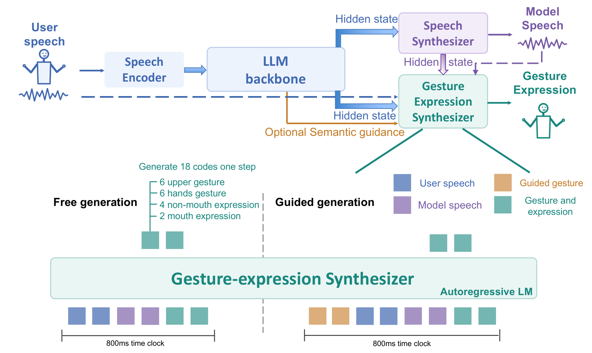
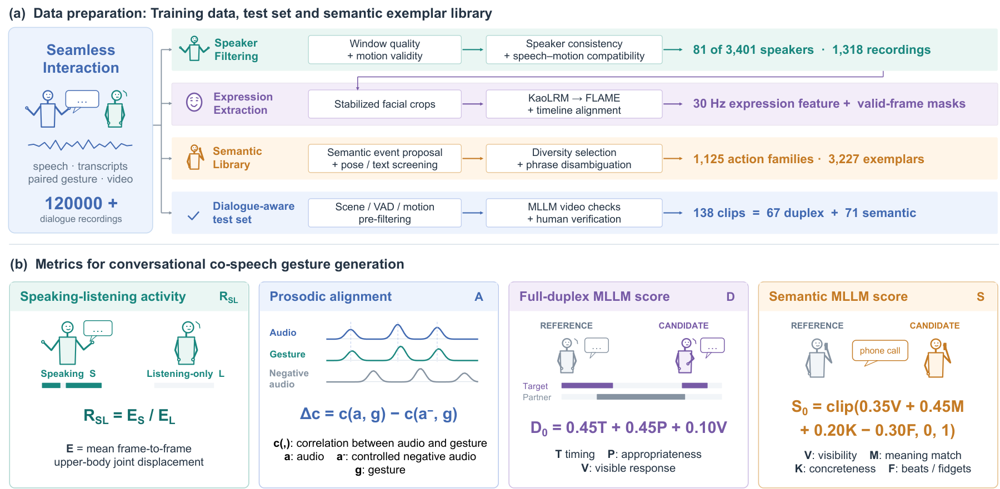

# ELLSA 2: Full-Duplex Interaction with Speech, Expressions and Gestures

<div align="center">

<div>
    <a href="https://arxiv.org/pdf/2610.21452" target="_blank">
      
    </a>
    <a href="https://github.com/bytedance/SALMONN/tree/ELLSA2" target="_blank">
      
    </a>
    <a href="https://huggingface.co/tsinghua-ee/ELLSA2" target="_blank">
      
    </a>
    <a href="https://huggingface.co/datasets/tsinghua-ee/ELLSA2_data" target="_blank">
      
    </a>
    
</div>

</div>

ELLSA 2 studies how a dialogue model can coordinate **speech, gestures, and facial expressions** while listening and speaking. A listener can nod or smile without taking a turn; a speaker can use a meaningful hand gesture alongside an utterance. The paper brings these verbal and non-verbal behaviors into a unified full-duplex dialogue framework.

**Current release:** data selection and preparation, the evaluation pipeline, the human-verified test set and the causal streaming Standalone generator for dialogue-conditioned gestures and expressions.

[Highlights](#highlights) · [Release contents](#release-contents) · [Setup](#setup) · [Inference](#inference) · [Demo](#interactive-demo) · [Training](#training) · [Evaluation](#evaluation)

## Highlights

- **Coordinated full-duplex interaction.** The full system described in the paper jointly models spoken interaction and non-verbal behavior, including reactions during verbal silence.
- **Dialogue-aware gesture and expression generation.** An autoregressive synthesizer processes speaking and listening conditions in 0.8-second blocks and predicts upper-body, hand, facial-expression, and mouth-motion codes.
- **Contextual semantic gestures.** The paper separates deciding when to invoke a semantic gesture from realizing it through template guidance, supported by dialogue representations and curriculum training.
- **Data and evaluation for conversation.** Speaker filtering and facial supervision support training; a human-verified benchmark measures speaking/listening activity, prosodic alignment, duplex behavior, gesture meaning, and facial motion.

<p align="center">
    
</p>

*Overview of ELLSA 2. ELLSA 2 jointly models full-duplex speech, gesture, and facial expression generation.*

## Release contents

| Package | Contents | Distribution |
| --- | --- | --- |
| [Data](data/README.md) | 138-clip dialogue gesture benchmark, speaker selection, facial-label preparation and RVQ preprocessing | [Hugging Face dataset package](https://huggingface.co/datasets/tsinghua-ee/ELLSA2_data) |
| [Code](code/README.md) | Standalone generator, training, inference, rendering, evaluation and Gradio demo | [GitHub code package](https://github.com/bytedance/SALMONN/tree/ELLSA2) |
| [Checkpoints](checkpoints/README.md) | Causal Standalone generator, ASR-only training initializer and RVQs | [Hugging Face model package](https://huggingface.co/models/tsinghua-ee/ELLSA2) |

<p align="center">
    
</p>

*Data preparation and evaluation overview.*

For local use, keep the three package directories together:

```text
ELLSA2/
├── README.md
├── code/                  # Standalone generator and runnable tools
├── data/                  # Test set, manifests, and preprocessing
└── checkpoints/           # Generator weights and RVQ tokenizers
    └── external_assets/   # Bundled KaoLRM and locally downloaded geometry
```

## Setup

Here we provide a conda environment setup for the project. The release environment pins PyTorch 2.9.0 with CUDA 12.6 and Transformers 5.2.0.

```bash
conda create -n ellsa2 python=3.12 pip -y
conda activate ellsa2
cd code
bash scripts/install_environment.sh
```

If data or weights are downloaded elsewhere, set their roots before running commands:

```bash
export ELLSA2_DATA_ROOT=/path/to/data
export ELLSA2_CHECKPOINT_ROOT=/path/to/checkpoints
```

## Inference

All commands in this and the following sections run from `code/`.

### Included conversation

Generate motion for an included conversation:

```bash
python infer.py --model-path ../checkpoints/standalone_generator --test-id fro_00038 --output-dir outputs/example
```

Use `--model-path` (also accepted as `--model_path`) to select the generator checkpoint explicitly. Replace the path above with your own compatible trained checkpoint directory, containing `config.json`, model weights, and tokenizer files. The released gesture/expression RVQ tokenizers are loaded separately from the checkpoint root.

### Your own audio

Supply the target person's audio, the aligned partner audio, and aligned 30 fps SMPL-H / raw FLAME motion-style references with at least 612 frames. For custom style data, pass both `--motion-style-pose-path` and `--motion-style-flame-path`. You can use the included style clip and its automatically detected FLAME reference:

```bash
python infer.py --model-path ../checkpoints/standalone_generator \
  --audio-path /path/to/target.wav \
  --audio-listen-path /path/to/partner.wav \
  --motion-style-pose-path ../data/testset/style/fro_00038.npz \
  --motion-style-start 0 --motion-style-length 612 \
  --output-path outputs/custom.npz
```


### Generate and render together

Add `--render true` to either command above to render gestures and facial expressions together:

```bash
python infer.py --model-path ../checkpoints/standalone_generator --test-id fro_00038 --output-dir outputs/example \
  --render true \
  --smplx-model ../checkpoints/external_assets/smplx/SMPLX_NEUTRAL_2020.npz
```

It uses the separately obtained SMPL-X neutral 2020 asset (100 expression coefficients), FFmpeg with libx264/AAC, and EGL/OpenGL; install these using the [installation guide](code/README.md#installation). `--smplx-model` defaults to the path shown above under the checkpoint root. The option also works with batch `--audio-json` input; each video is saved beside its corresponding NPZ.

## Interactive demo

Follow the [asset download guide](checkpoints/README.md#external-assets-sources-and-download-guide) to obtain SMPL-X neutral 2020 and place it under `checkpoints/external_assets/smplx/`. Install FFmpeg and ffprobe 6 or newer with libx264 and AAC encoding, plus EGL/OpenGL support.

```bash
# Install the GPL build to provide libx264 and AAC encoding.
conda install -c conda-forge 'ffmpeg>=6=gpl_*' --freeze-installed -y
python -m pip install -r demo/requirements.txt
python demo/app.py \
  --smplx-model ../checkpoints/external_assets/smplx/SMPLX_NEUTRAL_2020.npz
```

Open **http://127.0.0.1:7860**, upload aligned target and partner audio, and generate an animated video. The demo uses the Standalone generator. The demo decodes completed RVQ windows and renders them while later motion is generated. Preview and downloads use the same committed motion. Set `--decode-window-blocks 1` to decode every completed 0.8-second block without future RVQ context, or `0` to wait for whole-sequence decoding. See the [demo guide](code/demo/README.md).

## Training

Prepare source files and raw facial labels using the [data guide](data/README.md#prepare-the-selected-training-inventory), then run the two stages:

```bash
conda activate ellsa2
NPROC_PER_NODE=8 bash scripts/train.sh --stage expression
NPROC_PER_NODE=8 bash scripts/train.sh --stage gesture_expression
```

The ASR-only base is already trained. See the [training guide](code/README.md#training) for stage transfer, GPU batch settings and fine-tuning.

## Evaluation

Generate all 138 benchmark predictions:

```bash
python scripts/prepare_testset.py --output-dir outputs/test
python infer.py --model-path ../checkpoints/standalone_generator --audio-json outputs/test/inference_jobs.json --output-dir outputs/test
```

Choose a metric group with `--metrics {motion,face,mllm,all}`. The default is `motion`. `motion` computes objective gesture metrics, `face` computes expression metrics, `mllm` runs Gemini/Seed gesture judging, and `all` runs all three. Each group checks only its required inputs.

```bash
python evaluation/evaluate.py --metrics motion \
  --prediction-dir outputs/test --output-dir outputs/metrics_motion \
  --smplx-model ../checkpoints/external_assets/smplx/SMPLX_NEUTRAL_2020.npz

python evaluation/evaluate.py --metrics face \
  --prediction-dir outputs/test --output-dir outputs/metrics_face \
  --flame-asset-dir ../checkpoints/external_assets/flame --device cuda:0
```

For online `mllm` or `all`, configure Gemini and Seed independently with `--gemini-api-key` / `--seed-api-key`, or the `GEMINI_API_KEY` / `SEED_API_KEY` environment variables. Endpoints and model identifiers are also explicit options. The [evaluation guide](code/evaluation/README.md#choose-a-metric-group) provides complete commands, Azure-compatible settings and offline aggregation with `--mllm-score-dir`. 

## Code structure

```text
code/
├── modeling_ellsa2.py        # Autoregressive gesture-expression model
├── dataset.py             # Training dataset and motion/style loading
├── train.py, infer.py      # Public training and inference entry points
├── configs/               # Training recipe and DeepSpeed configuration
├── models/vq/             # Gesture and expression RVQ tokenizers
├── evaluation/            # Metrics, rendering, and judge aggregation
├── demo/                  # Interactive Standalone-generator demo
├── scripts/               # Launchers and shared inference helpers
└── tests/                 # Regression tests
```


## Acknowledgements and license

This work builds on [Qwen](https://huggingface.co/Qwen/Qwen2.5-0.5B), [MECo](https://github.com/RobinWitch/MECo), [SPEAR](https://huggingface.co/collections/marcoyang/spear-encoders), [Seamless Interaction](https://github.com/facebookresearch/seamless_interaction), [GestureLSM](https://github.com/andypinxinliu/GestureLSM), [KaoLRM](https://github.com/CyberAgentAILab/KaoLRM), [SMPL-H/SMPL-X](https://github.com/vchoutas/smplx), [FLAME](https://flame.is.tue.mpg.de), and [UniLS](https://github.com/xg-chu/UniLS). We thank their authors for the datasets, pretrained components and evaluation implementations.

Repository-authored code retains the [Apache-2.0 license](code/LICENSE). Third-party code, datasets, weights, and body/face assets retain their respective upstream terms; see the [code notices](code/THIRD_PARTY_NOTICES.md) and [asset sources and download guide](checkpoints/README.md#external-assets-sources-and-download-guide).

## Citation
If you find this project useful, please consider citing our work:
```bibtex
@article{wang2026ellsa2,
    title={Full-Duplex Interaction with Speech, Expressions and Gestures}, 
    author={Siyin Wang and Wenyi Yu and Terumi Chiba and Xianzhao Chen and Xiaohai Tian and Jun Zhang and Lu Lu and Chao Zhang},
    journal={arXiv preprint arXiv:2610.21452},
    year={2026}
}
```
